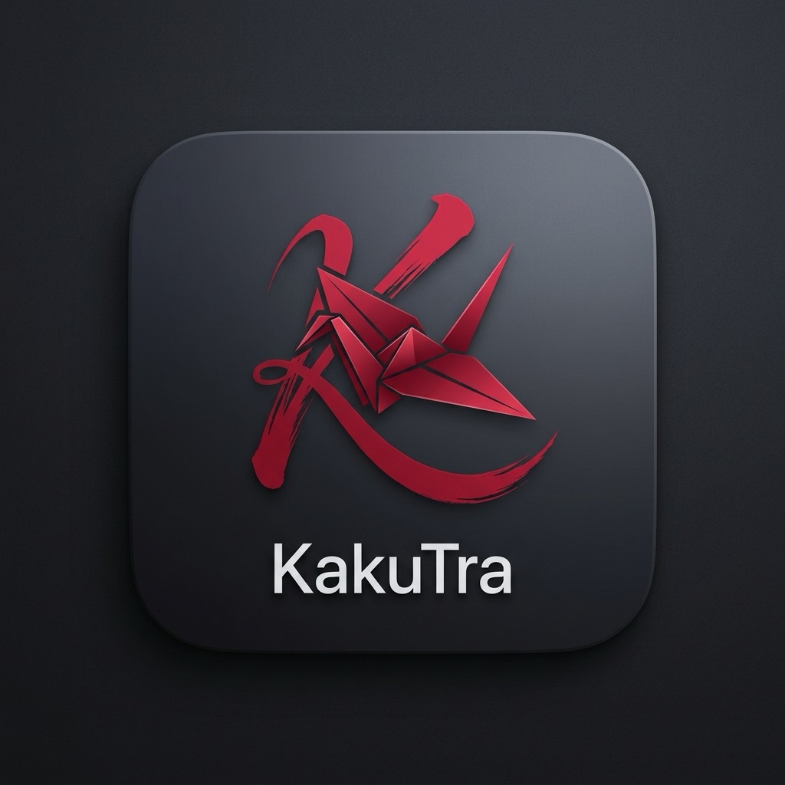
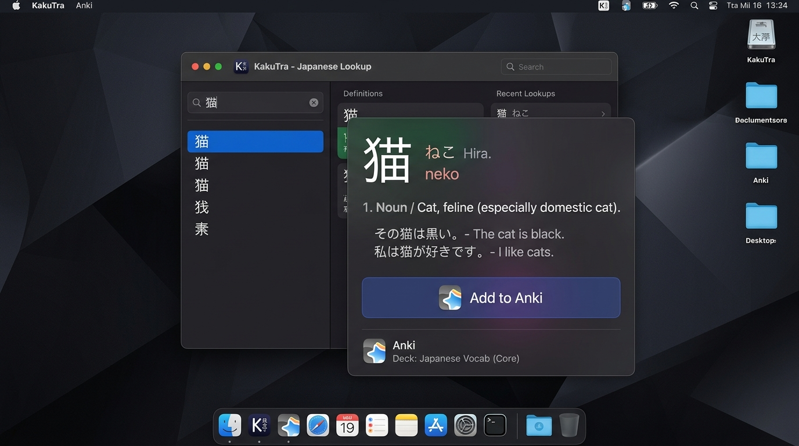

# KakuTra

<p align="center">
  
</p>

<p align="center">
  <strong>Assistant macOS d’immersion et d’apprentissage du japonais</strong><br>
  <em>OCR & Accessibilité en lecture seule · Dictionnaires Yomitan locaux · Création volontaire de cartes Anki</em>
</p>

<p align="center">
  
</p>

---

## Philosophie et principes clés

KakuTra est conçu pour les apprenants du japonais sur macOS qui souhaitent lire confortablement (mangas, romans, articles, sous-titres) et enrichir leur vocabulaire de manière fluide et sécurisée.

1. **Zéro accès au presse-papiers** : KakuTra ne lit, n'écrit et ne simule jamais `Cmd+C` sur le presse-papiers système.
2. **100% Local et privé** : Les requêtes Yomitan (`127.0.0.1:19633`) et AnkiConnect (`127.0.0.1:8765`) s'exécutent en boucle locale fermée. Aucune capture d'écran, titre de fenêtre ou texte n'est envoyé sur internet.
3. **Écoute au survol avec pause explicite** : Examinez le texte sous le curseur sans maintenir obligatoirement un raccourci. Suspendez ou reprenez l'écoute en un clic depuis la barre des menus.
4. **Intégration Yomitan** : Exploite directement vos dictionnaires japonais déjà installés dans Yomitan (Jitendex, Daijirin, Kenkyusha, etc.), avec affichage distinct des sources et filtrage par langue de glossaire.
5. **Cartes Anki volontaires et protection contre les doublons** :
   - Prévisualisation complète avant ajout (terme, lecture, définition éditable, phrase de contexte extraite).
   - Prise en charge du texte vertical (*tategaki*) et horizontal.
   - Vérification préalable des doublons via `canAddNotes` : KakuTra n'écrase jamais silencieusement vos cartes.
   - Création directe d'une note unique via `addNote`.

---

## Installation et démarrage rapide

### Est-ce que l'installation est automatisée ?
**Oui !** 
- **Pour l'utilisateur final** : Téléchargez simplement `KakuTra.app` et glissez-la dans `/Applications`. Dès le lancement, KakuTra détecte automatiquement si Yomitan et Anki tournent sur votre machine.
- **Si vous compilez depuis les sources** : Un script en une ligne compile l'application, configure le bundle et installe `KakuTra.app` directement.

```bash
# Compiler et installer KakuTra.app en une seule commande :
./scripts/build_app.sh
```

---

## Prérequis

1. **macOS 14.0 ou supérieur** (Apple Silicon ou Intel).
2. **Autorisation Enregistrement d'écran** (obligatoire sur macOS pour permettre à Vision OCR de lire les caractères sous le pointeur).
3. **Yomitan** (extension navigateur avec l'API locale activée sur le port `19633`).
4. **Anki** avec le greffon [AnkiConnect](https://foosoft.net/projects/anki-connect/) installé (port par défaut `8765`).

---

## Configuration

Ouvrez les réglages depuis l'icône de la barre des menus :
- **Général** : Langue de l'interface, lancement à l'ouverture de session.
- **Services** : État de connexion à Yomitan, attribution d'une langue à chaque dictionnaire détecté.
- **Anki** : Choix du paquet (*Deck*), du type de note (*Note type*), et association des champs (Terme, Lecture, Définition, Contexte, Source, Tags).
- **Apprentissage** : Historique local hors ligne stocké dans SwiftData, avec possibilité d'export au format fichier TXT, TSV ou CSV.

---

## Licence

Projet open-source distribué sous licence MIT.
Voir le [plan maître du projet](file:///Users/yuuzaa/Developer/KakuTra/docs/PLAN-MAITRE-KAKUTRA.md) pour les détails d'audit et la documentation d'architecture.
